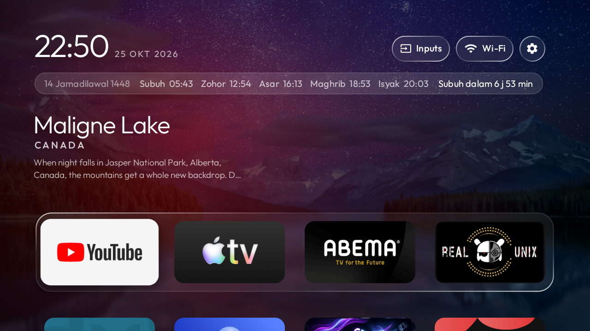
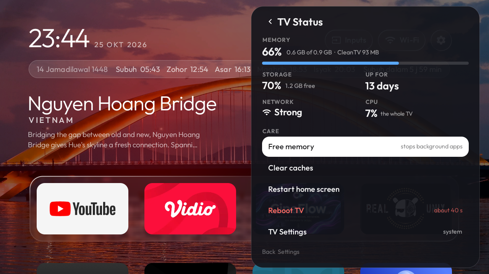
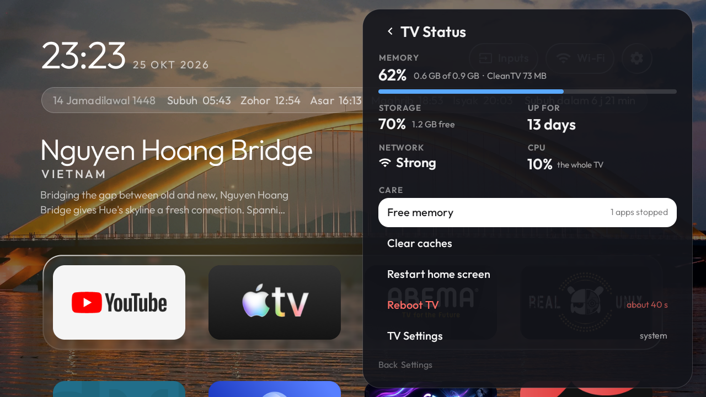

# Clean Your TV — Islamic Theme & TV Status Edition

<p align="center">
  
</p>

<p align="center">
  <a href="https://github.com/ssemyy-sds/cleanyourtv-app-islamic-theme/releases"></a>
  
  
  <a href="LICENSE"></a>
</p>

<h3 align="center">An enhanced community edition of <a href="https://github.com/udhaykumarbala/cleanyourtv-app">Clean Your TV</a> featuring Islamic prayer times, azan overlay, and an integrated TV Status & Care panel.</h3>

---

## Overview

This repository is a customized fork of **Clean Your TV**, tailored to bring together a serene, ad-free Android TV experience with daily Islamic prayer times and a full-featured TV diagnostic and care sidebar.

### Key Enhancements

* **🕌 Islamic Theme & Prayer Times Bar**:
  - Live prayer schedule: Subuh, Syuruk, Zohor, Asar, Maghrib, and Isyak with automatic countdown to the next prayer.
  - Hijri calendar display alongside Gregorian date and clock.
  - Azan notification banner and audio overlay when prayer time arrives, even while watching streaming apps (YouTube, Netflix, Live TV).
  - Fully configurable via `config.json` (coordinates, calculation method, audio assets).
* **📊 TV Status & Device Care Drawer**:
  - Frosted dark-glass settings drawer adapted from **Weatherglass TV**.
  - **Live Hardware Telemetry**: Real-time RAM utilization bar, internal storage free space, TV uptime counter, Wi-Fi RSSI signal / Ethernet detection, and live CPU load.
  - **TV Care Tools** (powered by pure Java loopback ADB on port 5555):
    - **Free memory**: Terminate non-critical background processes with live process count feedback.
    - **Clear caches**: Trim cache across installed system packages.
    - **Restart home screen**: Rapid 1-second launcher reload to refresh tiles, wallpapers, and widgets without rebooting the TV.
    - **Reboot TV**: Full hardware reboot with double-click safety confirmation.
    - **TV Settings**: Instant shortcut directly to native Android TV Settings.
* **🎯 Refined TV D-Pad Navigation**:
  - Built-in focus boundary trapping (*Focus Trap*): Navigating up or down inside the drawer stops cleanly at the top (**Free memory**) and bottom (**TV Settings**) without accidentally jumping back to the home screen tiles.

---

## Visual Showcase

| Islamic Home Screen | TV Status & Telemetry | Device Care in Action |
| :---: | :---: | :---: |
|  |  |  |
| *Serene home screen with prayer bar, countdown timer, and high-definition dynamic wallpaper.* | *Hardware telemetry: RAM percentage, storage free, uptime, Wi-Fi strength, and CPU load.* | *One-click background memory cleaner with instant feedback and cache clearing.* |

---

## How It Works

You have two easy ways to use this launcher:

### Option A: Via the Phone Companion App (No Computer Needed)
1. **Connect**: Install the companion app on any Android phone connected to the same Wi-Fi as your TV. Enable Network Debugging on your TV.
2. **Analyse**: The app reads your TV model, recommends apps to disable safely, and selects the bundled Islamic launcher.
3. **Clean**: Tap "Make it clean". The TV automatically transitions to the new Islamic home screen.

### Option B: Direct Sideloading (Using ADB)
If you prefer direct installation without the phone companion:
```bash
# Connect to your Android TV
adb connect <TV_IP_ADDRESS>:5555

# Install the bundled launcher
adb install -r android/platform/src/main/assets/bundled/cleanyourtv-launcher.apk

# Push prayer configuration and azan audio (optional)
adb push config.json /sdcard/Android/data/com.gathin.tvhome/files/
adb push azan.mp3 /sdcard/Android/data/com.gathin.tvhome/files/
adb push azan-subuh.mp3 /sdcard/Android/data/com.gathin.tvhome/files/

# Launch the home screen
adb shell am start -n com.gathin.tvhome/.MainActivity
```

---

## Safe By Design

- **Non-Destructive**: No system packages are uninstalled; bloatware is only disabled for user `0`, making everything reversible at any time.
- **Fail-Safe Watchdog**: If the launcher does not receive confirmation during initial phone setup within 150 seconds, the TV automatically restores its stock home screen.
- **Self-Contained ADB Client**: Telemetry and care actions communicate internally via `127.0.0.1:5555` with zero external network dependencies.
- **Completely Private**: No tracking, no external analytic servers, and no ads.

---

## Project Structure

- `android/platform/src/main/assets/bundled/cleanyourtv-launcher.apk`: The prebuilt and pinned Islamic launcher APK bundled inside the phone companion app.
- `core/trust/src/main/kotlin/tv/cleanyour/core/trust/Pins.kt`: Cryptographic pins (SHA-256 and byte size) ensuring binary integrity during phone deployment.
- `docs/images/`: Screenshots, banners, and testing evidence captured from real Android TV hardware.

---

## Credits & Acknowledgements

This edition stands on the shoulders of several wonderful open-source projects and authors:

1. **[udhaykumarbala/cleanyourtv-app](https://github.com/udhaykumarbala/cleanyourtv-app)**
   - Created by [Udhay Kumar Bala](https://github.com/udhaykumarbala).
   - Provided the Android phone companion app architecture, TV connection protocol, debloat profiles, and automated phone-to-TV deployment pipeline.
2. **[Gathin23/cleanyourtv](https://github.com/Gathin23/cleanyourtv)**
   - Created by [Gathin](https://github.com/Gathin23).
   - Provided the foundational minimalist Android TV launcher (`tvhome`), dock design, smooth animation physics, and community debloat profiles.
3. **[Pokka99/cleartv-Islamic](https://github.com/Pokka99/cleartv-Islamic)**
   - Created by [Pokka99](https://github.com/Pokka99).
   - Contributed the Islamic theme features: prayer calculation engine, Hijri date converter, azan audio player, bottom overlay service, and wallpaper backgrounds.
4. **[faizaldjoo/weatherglass-tv](https://github.com/faizaldjoo/weatherglass-tv)**
   - Created by [Faizal](https://github.com/faizaldjoo).
   - Contributed the TV Status Drawer UI layout and system diagnostics concept (live RAM progress, storage, uptime, Wi-Fi RSSI, CPU usage, and care actions).
5. **[mobile-dev-inc/dadb](https://github.com/mobile-dev-inc/dadb)**
   - Pure Kotlin/Java ADB implementation for device-to-device and local communication.
6. **[Outfit Font Family](https://github.com/Outfitio/Outfit-Fonts)**
   - Clean, modern typography designed for TV viewing distances (SIL Open Font License 1.1).

---

## Licence

Licensed under the **MIT Licence**, consistent with Clean Your TV and upstream community projects. See [LICENSE](LICENSE) for details.
